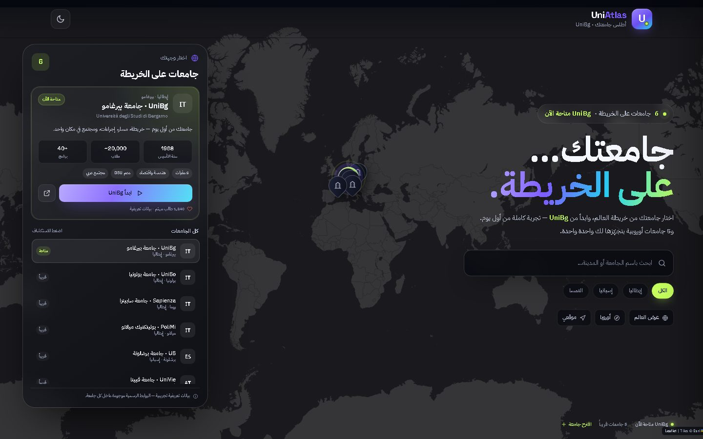
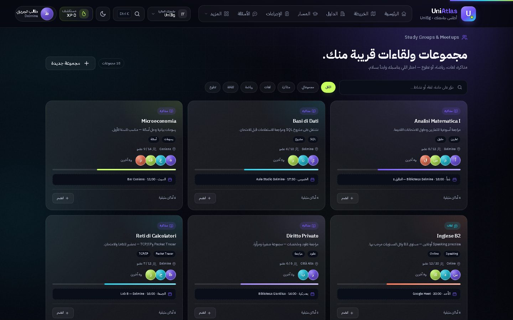
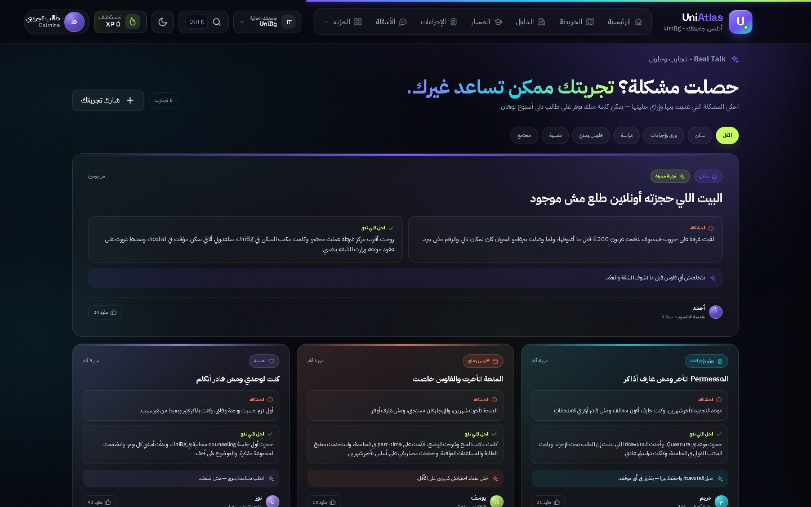
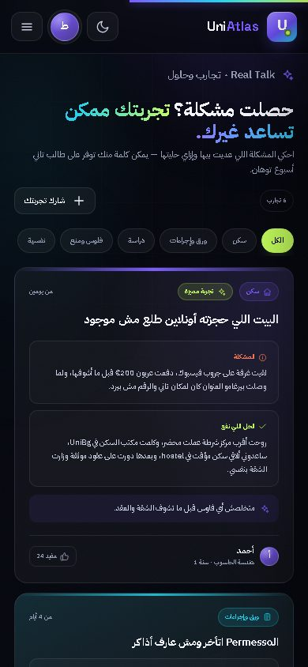
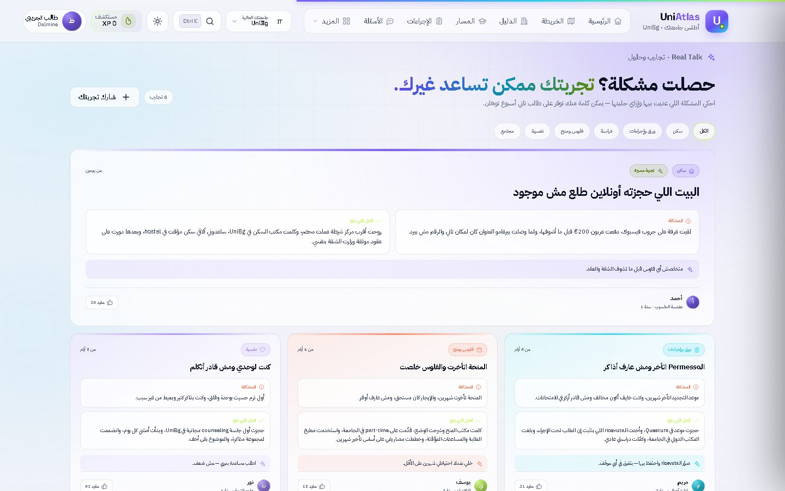

# UniAtlas — أطلس جامعتك

> **جامعتك… على الخريطة.**
>
> تجربة طالب عربية (RTL) تبدأ بخريطة العالم لاختيار الجامعة، و**UniBg** هي الجامعة المتاحة بالكامل الآن. باقي الجامعات تظهر كـ«قريباً» ويقدر الطالب يسجّل اهتمامه بيها.



## ليه UniAtlas؟

- **Map-first**: تختار جامعتك من خريطة العالم، مش من قائمة طويلة.
- **تجربة UniBg كاملة**: مباني، مسار أكاديمي، إجراءات، بنك أسئلة، سكن، منح، تدريب، ومساحة شخصية.
- **مجتمع حقيقي**: مجموعات طلاب، فعاليات، لوحة نقاش بالردود، وقسم **«تجارب وحلول»** لمشاركة المشكلة والحل.
- **RTL أصلي**: كل الواجهة والنسخ مصممة للعربي، مع أرقام واتجاهات مضبوطة.
- **يعمل بدون Build tooling**: HTML/CSS/JS + Leaflet، ومكوّن ووردبريس جاهز للرفع.
- **Local-first**: كل بيانات الطالب تتحفظ في `localStorage` — مفيش سيرفر ولا تتبّع.

## جولة سريعة

| المجتمع والمجموعات | تجارب وحلول |
|---|---|
|  |  |

<p align="center">
  
  
</p>

## الأقسام

1. **الرئيسية** — ملخص سريع لكل حاجة.
2. **الخريطة التفاعلية** — مقرات UniBg ومبانيها.
3. **دليل المباني** — بحث وفلترة حسب النوع والمقر.
4. **المسار الأكاديمي** — مواد، CFU، وحالة كل مادة.
5. **دليل الإجراءات** — Permesso، Codice Fiscale، ISEE… خطوة بخطوة.
6. **بنك الأسئلة** — أسئلة شفهية، بروفيسورات، وبطاقات مراجعة.
7. **المجتمع والحياة** — مجموعات، فعاليات، لوحة نقاش بالردود، تجارب وحلول، خصومات، ومواصلات.
8. **السكن والغرف** — خيارات تجريبية مع حفظ ومقارنة وتفاصيل.
9. **المنح والرسوم** — حاسبة ISEE تقريبية، شرائح الرسوم، ومنحة DSU.
10. **التدريب والوظائف** — فرص تجريبية، حفظ، وتفاصيل + قائمة تجهيز CV.
11. **مساحتي** — كل المحفوظات، الاهتمامات، المساهمات، والاقتراحات في مكان واحد.

## التشغيل السريع

```bash
# معاينة مباشرة
start preview.html        # Windows
# أو: open preview.html   # macOS

# إعادة بناء preview + أصول البلجن
node build.js
```

محتاج إنترنت للخريطة (Leaflet/Esri) والخطوط (Google Fonts). مفيش Dependencies.

## التركيب على ووردبريس

1. من لوحة ووردبريس: **بلجنات ← أضف جديد ← رفع بلجن**.
2. ارفع `uniatlas.zip`.
3. اضغط **تفعيل** — البلجن هينشئ صفحة **UniAtlas** فيها `[uniatlas]` تلقائياً.
4. افتح الصفحة. لو محتاج صفحة يدوية، ضع الشورت كود `[uniatlas]` (والقديم `[unibg_super_app]` شغال برضه).

بعد التفعيل تقدر تضيف جامعات من **UniAtlas ← مدير الجامعات**، وتظبط القالب والإعدادات من **UniAtlas ← الإعدادات**.

## بنية المشروع

| المسار | الوصف |
|---|---|
| `src/markup.html` | هيكل الواجهة — المصدر. |
| `src/styles.css` | كل التنسيقات — المصدر. |
| `src/app.js` | المنطق والبيانات التجريبية — المصدر. |
| `build.js` | يبني `preview.html` وأصول البلجن من `src`. |
| `preview.html` | معاينة مستقلة تعمل بفتحها في المتصفح. |
| `plugin/uniatlas/` | بلجن ووردبريس كامل. |
| `uniatlas.zip` | البلجن جاهز للرفع. |
| `README-AR.md` | الدليل الكامل بالعربي. |

## البيانات والخصوصية

كل البيانات المعروضة **تجريبية للعرض** — المباني، المواد، البروفيسورات، المواعيد، أسعار السكن، الرواتب، شرائح الرسوم، وأسئلة المقابلات، وكذلك محتوى المجتمع (المجموعات، الفعاليات، المنشورات، التجارب، والعروض). مفيش أي بيانات رسمية من الجامعة.

- تفضيلات الطالب بتتخزن في `localStorage` تحت المفتاح `uniatlasState.v2`.
- مفيش أي بيانات بتتبعت لسيرفر.
- قبل الاعتماد على أي معلومة (رسوم، منح، مواعيد، سكن)، ارجع للموقع الرسمي للجامعة.

## الترخيص

البلجن والتجربة تحت رخصة **GPL-2.0-or-later**. راجع [LICENSE](LICENSE).

البيانات التجريبية والأسماء والعلامات التجارية ملك أصحابها. UniAtlas مش تابع لأي جامعة.

---

صُنع بحب، من طالب لطالب. 🎓
